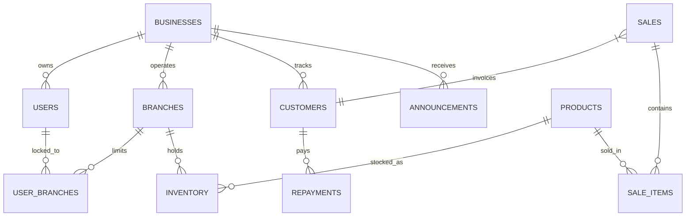

# TraderERP – System Architecture & Development Documentation

TraderERP is a premium, multi-tenant enterprise management platform built for modern retail, wholesale, and branch-based businesses. It provides a highly responsive, mobile-first operations interface comprising Sales POS, Inventory Control, Customer CRM, Debt Management, and Advanced Reporting modules, wrapped in a secure multi-tenant isolation layer.

---

## 1. Core Technology Stack

TraderERP utilizes a modern, robust, and fast software stack to achieve premium performance and responsiveness:

*   **Frontend Framework**: **Next.js 16 (App Router)**. Uses React Server Components (RSC) for page loads, Server Actions for secure database mutations, and Next.js Route Groups (`(app)`, `(auth)`, `(onboarding)`, `(platform)`) to segregate route permissions.
*   **Database & Auth**: **Supabase (PostgreSQL)**. Backed by PostgreSQL tables, relational foreign keys, stored procedures, database-level constraints, and Row Level Security (RLS) policies.
*   **State Management**: **Zustand**. Client-side state manager used to persist selections (such as the active branch, user theme preference, and notifications read timestamps) in `localStorage` without causing redundant re-renders.
*   **Styling & Design System**: **Tailwind CSS v4** & Vanilla CSS. Utilizes HSL-tailored colors, smooth gradients, dynamic scale transitions, and custom glassmorphism components. The dark/light mode toggle operates by dynamically switching core Tailwind variables (`--color-slate-950`, `--color-slate-900`, etc.) on the root HTML element.
*   **Icons**: **Lucide React** vectors for clean UI visuals.
*   **Build Engine**: **Next.js Turbopack** for rapid local compilation.
*   **Offline Compilation**: Removed Google Fonts API dependencies (`next/font/google`), relying on robust local system font stacks to ensure network-independent, highly-available offline compilation.

---

## 2. System Architecture & Relational Design

The backend uses a relational database schema structured to manage multiple business tenants, branches, products, sales, and accounts receivable:

### Database Schema Definitions
*   **`businesses`**: Root tenant workspace configuration.
*   **`users`**: Profiles containing auth relations, role identifiers (`OWNER`, `ADMIN`, `MANAGER`, `STAFF`), status (`ACTIVE`, `SUSPENDED`, `RESTRICTED`, `DELETED`), and password flags.
*   **`branches`**: Outlets operated under a business, assigned to a manager.
*   **`user_branches`**: Maps managers/staff to their specific assigned outlet.
*   **`products`**: Central catalog tracking product names, barcodes, SKUs, and default cost/selling prices.
*   **`inventory`**: Logs quantities and reorder levels mapped per-branch.
*   **`sales` & `sale_items`**: Logs checkout operations, invoice calculations, payment methods, operator IDs, and items.
*   **`repayments`**: Mapped to customers to record credit collection installments.
*   **`support_tickets`**: Tracks customer support queries and administrative answers.
*   **`announcements`**: Broadcast database for system-wide platform notifications.

---

## 3. Multi-Tenant Isolation & Security Design

TraderERP implements a strict **defense-in-depth** security pattern to guarantee complete multi-tenant boundary isolation and prevent unauthorized data modifications:

### Supabase Row-Level Security (RLS)
Every database table is protected by active RLS policies. Data operations (`SELECT`, `INSERT`, `UPDATE`, `DELETE`) are gated by JWT session verification ensuring that:
1. Users can only select or mutate records where the `business_id` matches their authenticated session metadata.
2. Managers and staff can only read or edit inventory details corresponding to their assigned branch.

### Live Session Revocation & Real-Time Validation
To bypass the standard 1-hour expiration delay of JWT access tokens, all database mutations (Server Actions) execute live profile status queries (`validateWriteAccess` and `validateReadAccess`) directly against the Supabase database. 
*   If an administrator suspends, restricts, or deletes an employee's account, their write permissions are revoked **instantly**, locking them out on their very next click.
*   The proxy (formerly middleware) checks the user status and redirects unauthorized profiles back to the Login view.

### POS Sales Transaction Safety
The `public.process_sale` stored procedure runs as a database transaction. It verifies that:
*   The transaction quantity is strictly positive (`quantity > 0`).
*   The target branch belongs to the cashier's verified `business_id`.
*   The customer profile (if selected) is registered under the cashier's business.
*   Every single product ID in the sale list exists under the business's product catalog.
Any validation mismatch rolls back the entire database transaction, preventing cross-tenant stock manipulation exploits.

---

## 4. Key Functional Modules

*   **Sales POS**: Instant checkout dashboard supporting cash, card, and bank transfers. Generates clean invoice layouts and prompts cashiers for print receipts.
*   **Inventory Control**: Features reorder alert flags. Managers and staff are restricted to view/adjust stock levels inside their assigned branch, while owners can query global company outlets.
*   **Customer CRM**: Aggregates spend metrics per customer, tracking spent value, transaction counts, and registering branches.
*   **Debt CRM**: Tracks outstanding balances. Uses a First-In-First-Out (FIFO) aging algorithm to identify credits older than 30 days, labeling debtors with `Overdue` vs `Good` credit status badges.
*   **Advanced Reports**: Renders dual-timeline charts mapping revenue and realized profit, stock valuation metrics, and CSV spreadsheet exports. Supports CSS print overrides to output formatted PDFs.
*   **Announcements Feed**: Dedicated notifications inbox (`/notifications`) displaying global announcements sent by the platform owners.
*   **Super Admin Platform Console**: A closed portal (`/platform`) for platform owners (Super Admins) to monitor registered business entities, manage user overrides, resolve support center tickets, toggle feature flags, adjust global SMTP credentials, and inspect system-wide audit logs.

---

## 5. Development Methodology

TraderERP has been constructed using a modular, systematic development methodology:

1.  **Foundation Layer**: Design system definitions inside `globals.css` using slate-charcoal and blue glassmorphic themes, followed by database schema setup and migrations inside `/supabase/migrations`.
2.  **Server Actions Layer**: Constructing stateless backend mutations and validation rules in `/src/app/actions` (e.g. `auth.ts`, `inventory.ts`, `sales.ts`, `customers.ts`, `debts.ts`, `reports.ts`, `support.ts`, `platform.ts`, `notifications.ts`).
3.  **UI Component Layer**: Designing modular, reusable components inside `/src/components` with dynamic animations.
4.  **Responsive Optimizations**:
    *   **Dynamic Viewport Sizing (`dvh`)**: Used on layouts (`h-dvh` instead of standard `h-screen`) to prevent viewport clipping on mobile browsers due to dynamic address bars.
    *   **Whole-Container Scrolling**: Outer scroll layouts on `Sidebar.tsx` allow mobile users to drag and swipe anywhere on the sidebar drawer to scroll links smoothly.
    *   **Tap Bubble Propagation**: Formatted sidebar link sub-components with `pointer-events-none` to guarantee click events bubble up directly to `<Link>` wrappers on mobile safari/chrome, closing drawers immediately.
    *   **Top Header Theme Toggle**: Repositioned the theme toggle from the sidebar footer to the main layout header for quick, non-intrusive access.

---

## 6. Versioning & Incremental Releases

TraderERP follows the **Semantic Versioning (SemVer)** paradigm for updates:

*   **Format**: `vMAJOR.MINOR.PATCH` (e.g., `v0.1.0` - MVP Release).
*   **Major Updates**: Incremented for core architecture overhauls.
*   **Minor Updates**: Incremented for new feature additions (such as the Support Center, Announcements module, and Forgot Password recovery flow).
*   **Patch Updates**: Incremented for styling tweaks, mobile responsiveness alignments, and code validation fixes.
*   **Schema Migrations**: Database migrations are staged sequentially inside `supabase/migrations/` using timestamp prefixes (e.g., `20260605000001_staff.sql` through `20260606000000_input_validation_fixes.sql`). This ensures schema changes are applied incrementally and transparently across development, staging, and production environments.
